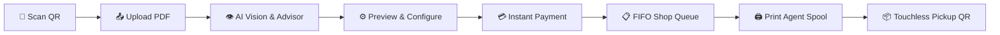

# 🖨️ SmartPrint

> **QR-Based Smart Printing Platform with Built-in AI Intelligence**  
> Streamlined, touchless printing for students and campus print shops. Upload documents, customize print settings with AI assistance, pay online, and pick up your prints with zero waiting in line.

[](docs/RELEASE_NOTES.md)
[](apps/web)
[](apps/api)
[](apps/api)
[](apps/api)
[](LICENSE)

---

## 📑 Table of Contents

- [Overview](#overview)
- [How It Works](#how-it-works)
- [✨ Key Features](#-key-features)
  - [🧠 SmartPrint AI Suite](#-smartprint-ai-suite-new)
  - [📱 Customer Experience](#-customer-experience)
  - [🏪 Shop Owner Operations](#-shop-owner-operations)
  - [🖨️ Local Print Agent](#️-local-print-agent)
- [Monorepo Structure](#monorepo-structure)
- [Quick Start Guide](#quick-start-guide)
  - [Prerequisites](#prerequisites)
  - [Running Locally](#running-locally)
  - [AI Mode & Payments Configuration](#ai-mode--payments-configuration)
- [Available Scripts](#available-scripts)
- [Environment Variables](#environment-variables)
- [Documentation Index](#documentation-index)

---

## Overview

SmartPrint bridges the gap between campus students who need fast, hassle-free printing and print shop operators dealing with long queues, manual file transfers, and cash management.

Instead of waiting in physical queues or sharing USB drives and emails, students scan a shop QR code, configure their print jobs with real-time AI guidance, pay digitally, and receive live progress tracking until their order is ready for pickup.

---

## How It Works



1. **Scan QR Code**: Scan the QR sticker at any registered print shop to open the shop's portal.
2. **Upload Document**: Drag & drop or browse for PDF documents up to 25 MB.
3. **AI Vision & Configuration**: SmartPrint inspects your document to recommend cost-saving settings (duplex, color vs B&W, paper finish).
4. **Interactive Multi-Page Preview**: Review pages and choose individual color or black-and-white per page.
5. **Secure Digital Payment**: Pay via Razorpay UPI/cards or instant sandbox testing.
6. **Smart Queue Management**: Jobs enter an intelligent FIFO queue with live ETA updates.
7. **Automated Spooling**: The local print agent automatically claims and routes jobs to physical printers.
8. **Touchless Pickup**: Scan the pickup verification QR code at the counter to collect your prints without mix-ups.

---

## ✨ Key Features

### 🧠 SmartPrint AI Suite (New!)

SmartPrint incorporates Google Gemini 2.0 Flash to deliver an intelligent, guided printing experience for both customers and shop owners:

| AI Feature                     | Where It Appears      | What It Does                                                                                                                                                                           |
| ------------------------------ | --------------------- | -------------------------------------------------------------------------------------------------------------------------------------------------------------------------------------- |
| **👁️ PDF Vision Classifier**   | File Upload / Preview | Inspects document pages with multimodal vision to detect document types (e.g. academic notes, slide decks, certificates, posters) and suggests suitable paper weight (GSM) and finish. |
| **🤖 Print Config Advisor**    | Print Configuration   | Analyzes document length and layout to recommend budget-friendly settings (such as duplex printing to cut paper costs by up to 50%).                                                   |
| **⏱️ Smart ETA Predictor**     | Order Tracking        | Dynamically calculates pickup arrival time based on printer throughput, active queue volume, and shop peak hours.                                                                      |
| **🛡️ Order Risk Radar**        | Shop Owner Dashboard  | Flags potential printing hazards before printing starts (e.g., extremely high page counts, heavy ink coverage, or atypical page ratios).                                               |
| **💬 Plain-English Explainer** | Order Summary         | Translates technical printing terms into a transparent, student-friendly receipt breakdown.                                                                                            |
| **📊 Shop Trend Analysis**     | `/admin/trends`       | Performs analytical RAG over historical shop orders to reveal peak rush hours, top document categories, and 30-day revenue trends.                                                     |
| **📈 AI Dashboard Insights**   | `/admin` Overview     | Provides real-time operational advice for shop operators on toner levels, paper inventory warnings, and queue bottlenecks.                                                             |
| **🎙️ Voice Command Bar**       | Global Navigation     | Enables hands-free voice and quick text commands (e.g., _"Go to print queue"_, _"Check printer status"_, _"Track order #104"_).                                                        |

> 💡 **Zero Setup Required**: SmartPrint includes a built-in `AI_MODE=mock` mode that delivers realistic, instant responses out of the box without requiring any API keys. When you're ready for live AI, simply add a `GEMINI_API_KEY`!

---

### 📱 Customer Experience

- **Interactive Multi-Page PDF.js Preview**: Zoom in/out, fit-to-width, and preview exactly how each page looks before spending money.
- **Granular Page-Level Color Controls**: Set specific pages to Color and others to Black & White to optimize printing costs.
- **Draft Session Recovery**: Configurations automatically save as drafts with live countdown timers, preventing accidental data loss if refreshed.
- **Live Order Tracking**: Real-time status tracker (`PAID` ➔ `QUEUED` ➔ `PRINTING` ➔ `READY_FOR_PICKUP` ➔ `COLLECTED`).
- **Touchless QR Verification**: One-time digital pickup pass that prevents duplicate or misplaced orders.

---

### 🏪 Shop Owner Operations

- **Shop Admin Dashboard**: Real-time overview of daily revenue, completed prints, pending orders, and printer status.
- **FIFO Queue Prioritization**: Easily reprioritize urgent prints, place difficult jobs on hold, or resume held orders.
- **Order Triage & Validation**: Inspect job configurations, uploaded files, and customer notes before sending to print.
- **Multi-Printer Fleet Oversight**: Monitor multiple local printers, their online/offline heartbeat, and current job loads.

---

### 🖨️ Local Print Agent

- **Autonomous Background Worker**: Runs on the shop's local workstation, polling the central API for ready-to-print jobs via a secure bearer token.
- **Dual Spooling Modes**:
  - **Mock Spooler**: Simulates real-world printing delays for local testing and development.
  - **CUPS (`lp`) Integration**: Spools directly to physical USB and network printers on Linux/macOS.
- **Automatic Failure Handling**: Automatically reports printer paper jams or offline states and supports instant reprints.

---

## Monorepo Structure

```
smartprint/
├── apps/
│   ├── web/           # Next.js 15 customer web app & shop admin dashboard
│   ├── api/           # Express & TypeScript REST API with Gemini AI layer
│   └── print-agent/   # Local background daemon for physical printer spooling
├── packages/          # Shared types and utilities
└── docs/              # Architecture guides, API specs, and release documentation
```

| Package                   | Directory          | Tech Stack                                          | Role                                                 |
| ------------------------- | ------------------ | --------------------------------------------------- | ---------------------------------------------------- |
| `@smartprint/web`         | `apps/web`         | Next.js 15 (App Router), Tailwind CSS, Lucide Icons | Student customer UI + Shop owner dashboard           |
| `@smartprint/api`         | `apps/api`         | Express, TypeScript, Google Gen AI SDK, MongoDB     | Business logic, order drafts, AI analysis, payments  |
| `@smartprint/print-agent` | `apps/print-agent` | Node.js, TypeScript, CUPS / `lp`                    | Local printer polling, hardware spooling & heartbeat |

---

## Quick Start Guide

### Prerequisites

- **Node.js 20+** installed ([Node.js Downloads](https://nodejs.org/))
- **MongoDB** running locally or a free MongoDB Atlas connection string
- _(Optional)_ **Google Gemini API Key** for live AI features
- _(Optional)_ **Razorpay Test Keys** for live sandbox payments

---

### Running Locally

1. **Clone the repository and install dependencies**:

   ```bash
   git clone https://github.com/RohitSingh-45/smartprint.git
   cd smartprint
   npm install
   ```

2. **Start the API Server**:

   ```bash
   # In Terminal 1
   cp apps/api/.env.example apps/api/.env
   npm run dev:api
   ```

   _The API will be available at [http://localhost:4000](http://localhost:4000)_  
   _Health Check: [http://localhost:4000/api/health](http://localhost:4000/api/health)_

3. **Start the Web Application**:

   ```bash
   # In Terminal 2
   cp apps/web/.env.example apps/web/.env.local
   npm run dev:web
   ```

   _The web app will be available at [http://localhost:3000](http://localhost:3000)_  
   _Shop Admin Portal: [http://localhost:3000/admin](http://localhost:3000/admin)_

4. **Start the Local Print Agent** _(Optional for testing physical spooling)_:
   ```bash
   # In Terminal 3
   cp apps/print-agent/.env.example apps/print-agent/.env
   npm run dev:agent
   ```

---

### AI Mode & Payments Configuration

SmartPrint is pre-configured to work straight out of the box with zero external accounts:

#### 1. AI Configuration (`apps/api/.env`)

- **Default (Offline Mock)**:
  ```env
  AI_MODE=mock
  GEMINI_API_KEY=
  ```
  _Provides realistic instant mock AI recommendations, vision tags, and analytics without needing an API key._
- **Live Google Gemini 2.0 Flash**:
  ```env
  AI_MODE=real
  GEMINI_API_KEY=your_gemini_api_key_here
  ```

#### 2. Payment Configuration (`apps/api/.env`)

- **Default (Mock Payments)**:
  ```env
  PAYMENT_PROVIDER=mock
  ```
  _Clicking "Pay" in the customer UI immediately simulates a successful transaction._
- **Razorpay Sandbox/Production**:
  ```env
  PAYMENT_PROVIDER=razorpay
  RAZORPAY_KEY_ID=rzp_test_xxxxxxx
  RAZORPAY_KEY_SECRET=your_secret_here
  ```

---

## Available Scripts

Run these scripts from the repository root:

| Command                | Action                                                      |
| ---------------------- | ----------------------------------------------------------- |
| `npm run dev:web`      | Starts Next.js frontend dev server (`:3000`)                |
| `npm run dev:api`      | Starts Express backend dev server with hot reload (`:4000`) |
| `npm run dev:agent`    | Starts local print agent spooler daemon                     |
| `npm run build`        | Builds all packages and applications                        |
| `npm run lint`         | Runs ESLint across all workspaces                           |
| `npm run typecheck`    | Runs TypeScript compiler check across all workspaces        |
| `npm run format`       | Formats all code and markdown using Prettier                |
| `npm run format:check` | Verifies code formatting compliance                         |

---

## Environment Variables

### API (`apps/api/.env`)

| Variable            | Default                                | Description                                      |
| ------------------- | -------------------------------------- | ------------------------------------------------ |
| `PORT`              | `4000`                                 | Port for the backend API                         |
| `MONGODB_URI`       | `mongodb://127.0.0.1:27017/smartprint` | MongoDB connection URL                           |
| `CORS_ORIGIN`       | `http://localhost:3000`                | Allowed web frontend origin                      |
| `AI_MODE`           | `mock`                                 | `mock` (no key needed) or `real` (uses Gemini)   |
| `GEMINI_API_KEY`    | -                                      | Your Google Gemini API Key (when `AI_MODE=real`) |
| `PAYMENT_PROVIDER`  | `mock`                                 | `mock` or `razorpay`                             |
| `PRINT_AGENT_TOKEN` | `smartprint-dev-agent-token`           | Shared secret token between API and Print Agent  |

### Web (`apps/web/.env.local`)

| Variable               | Default                 | Description                  |
| ---------------------- | ----------------------- | ---------------------------- |
| `NEXT_PUBLIC_API_URL`  | `http://localhost:4000` | Backend API URL              |
| `NEXT_PUBLIC_APP_NAME` | `SmartPrint`            | Display name for the web app |

---

## Documentation Index

Explore in-depth documentation in the [`docs/`](docs/) directory:

- 🏗️ [System Architecture](docs/ARCHITECTURE.md) — Technical architecture, state machine, and data flow.
- 📋 [Feature Specification](docs/FEATURES.md) — Complete roadmap and sprint deliverables.
- 🧪 [QA Checklist](docs/QA_CHECKLIST.md) — End-to-end manual verification and testing suite.
- 🚀 [Release Notes](docs/RELEASE_NOTES.md) — Detailed version 1.0.0 release summary.
- 📜 [Changelog](docs/CHANGELOG.md) — Chronological history of project changes.
- ⚠️ [Known Limitations](docs/KNOWN_LIMITATIONS.md) — System boundaries and trade-offs.
- 🔮 [Roadmap](docs/ROADMAP.md) — Future plans for multi-shop support and native notifications.

---

## License

Private — All rights reserved.
